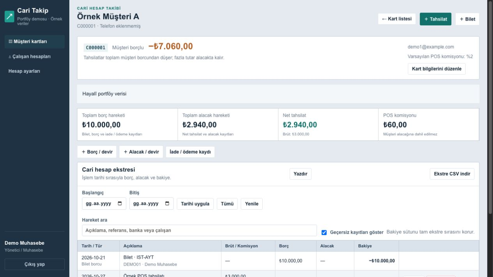
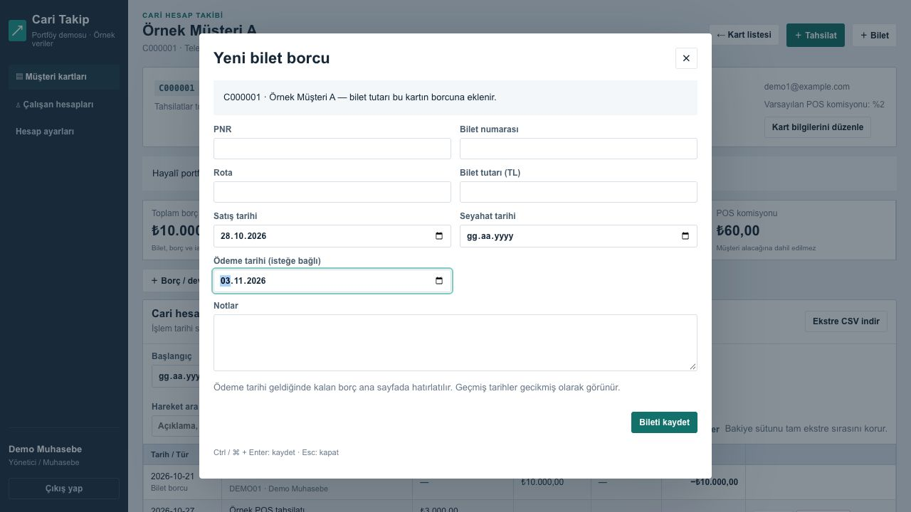

# ApexCari — Cari Hesap ve Bilet Takip Sistemi

React, Express ve MongoDB ile geliştirilmiş müşteri kartı, bilet borcu, bağımsız tahsilat ve ödeme tarihi takip uygulaması.

**Bu depo portföy sürümüdür.** Örnekler ve ekran görüntüleri hayalî veriler kullanır. Şirketin canlı sistemi, müşteri kayıtları ve veritabanı bağlantıları bu depoya dahil değildir.

## Çözülen problem

Bir müşterinin birden fazla bilet borcu ve biletten bağımsız ödemesi olabilir. ApexCari bu hareketleri sabit numaralı müşteri kartında toplar; borç, alacak, avans ve POS komisyonunu ayrı izler. Ödeme günü gelen açık borçlar ana sayfada görünür.

## Özellikler

- Sabit müşteri kart numarası; aynı isimli kişiler için ayrı hesaplar.
- Bilet oluşturma, düzenleme, iptal ve isteğe bağlı ödeme tarihi.
- Biletten bağımsız nakit, havale ve kart tahsilatı.
- Yüzde veya sabit tutarlı POS komisyonu; brüt, kesinti ve net tutar.
- Cari ekstre, tarih filtresi, yürüyen bakiye, CSV ve yazdırma.
- Bugün ödenecek ve gecikmiş biletler; kısmi ödeme sonrası kalan borç.
- Yönetici/çalışan yetkileri; gerekçeli düzeltme ve değişiklik geçmişi.
- Argon2id parola doğrulaması, HttpOnly oturum çerezi, sürüm çakışması kontrolü ve mükerrer tahsilat önleme.

## Ekran görüntüleri

Hayalî müşteriyle ödeme hatırlatmaları:


POS komisyonu ve yürüyen bakiyeyle müşteri ekstresi:



Bilet borcuna ödeme tarihi ekleme:



## Teknik yapı

| Katman | Kullanılan teknoloji |
| --- | --- |
| Arayüz | React 19, Axios, CSS |
| API | Node.js 22+, Express 5 |
| Veritabanı | MongoDB, Mongoose |
| Kimlik doğrulama | Argon2id, JWT, HttpOnly çerez |
| Test | Node.js test runner, Jest, React Testing Library |

```text
frontend/       React arayüzü ve etkileşim testleri
routes/         Kimlik doğrulama, müşteri, bilet ve çalışan API'leri
models/         MongoDB veri modelleri
lib/            Cari hesap, tutar, tarih ve hatırlatma kuralları
middleware/     Oturum kontrolü
scripts/        Yerel demo kurulumu ve hayalî veri yükleme
tests/          API, yetki ve hesaplama testleri
docs/images/    Hayalî verilerle hazırlanmış ekran görüntüleri
```

## Yerelde çalıştırma

Gerekenler: Node.js 22 veya üzeri, npm ve çalışan Docker Compose. Demo MongoDB ayrı bir yerel Docker biriminde tutulur.

```bash
git clone https://github.com/Gonul4/apexcari-demo.git
cd apexcari-demo
npm ci
npm ci --prefix frontend
npm run demo:setup
docker compose up -d
npm run demo:seed
```

MongoDB ilk açılışında birkaç saniye gerekebilir. Seed bağlantı hatası verirse veritabanı hazır olunca aynı komutu tekrar çalıştırın. Dolu veritabanına örnekler ikinci kez yazılmaz.

Bir terminalde API'yi başlatın:

```bash
npm start
```

İkinci terminalde arayüzü başlatın:

```bash
npm start --prefix frontend
```

Tarayıcıda **http://127.0.0.1:3000** adresini açın. Yerel demo hesapları:

| Rol | Kullanıcı adı | Yalnızca yerel demo parolası |
| --- | --- | --- |
| Yönetici | `demo.admin` | `DemoCari2026!` |
| Çalışan | `demo.calisan` | `DemoCari2026!` |

Örnekler bugüne, düne ve gelecek haftaya göre ödeme tarihleri oluşturur. İlk kartta 10.000 TL borç ve %2 komisyonlu 3.000 TL POS tahsilatı vardır: net 2.940 TL, kalan borç 7.060 TL.

Docker veritabanını veri silmeden durdurmak için `docker compose stop` kullanabilirsiniz. Yerel yapılandırma ve veri ayrımı ayrıntıları [SECURITY.md](SECURITY.md) içindedir.

## Hesaplama kuralları

Tutarlar hesaplamalarda kuruş olarak işlenir. Bakiye = toplam alacak − toplam borç. Eksi bakiye müşterinin borcunu, artı bakiye müşterinin avans/alacağını gösterir. Bilet iptali borcu kaldırır; tahsilatı silmez.

Hatırlatmalarda aktif tahsilat ve alacaklar en eski cari borçtan başlayarak dağıtılır. POS komisyonu sonrası net tutar kullanılır. Kapanan borçlar hatırlatmadan çıkar, kısmi ödemede kalan tutar görünür. Bu dağıtım asıl cari kayıtları değiştirmez. Gün hesaplamaları Europe/Istanbul saat dilimindedir.

## Kontroller

```bash
npm test
CI=true npm test --prefix frontend -- --watchAll=false
npm run build --prefix frontend
```

API testleri gerçek HTTP istekleri ve çerez akışını, bellekte taklit edilen veri erişimiyle sınar; haricî veritabanına bağlanmaz. Arayüz testleri form gönderimini, tarih geldiğinde hatırlatmayı, rol ve düzenleme akışlarını kontrol eder.

## Kapsam

Bu proje cari takip uygulamasıdır; resmî muhasebe, e-fatura veya banka/POS işlemi gerçekleştirmez. Haricî muhasebe entegrasyonu içermez. Portföy kopyası üretim sürümünden bağımsızdır.

Arayüzün geliştirme ve derleme araçları React Scripts 5 kullanır. Bu araç zincirinin modernizasyonu ayrı bir geliştirme alanıdır; demo kurulumu herkese açık üretim yayını için hazır bir hosting şablonu değildir.
