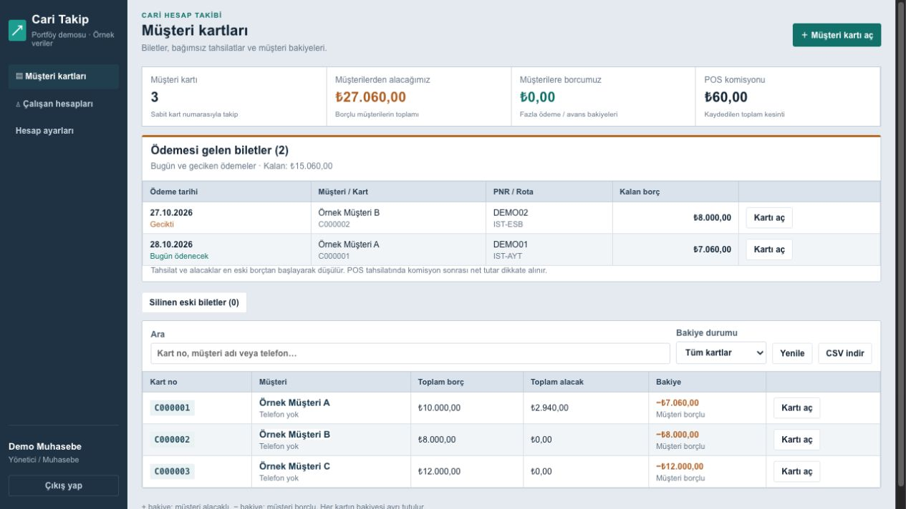

# Acenteler İçin Cari Hesap Tutumu

Acentelerde müşteri carilerini, bilet borçlarını ve tahsilatları takip etmek için geliştirdiğim uygulama.

Müşteri kartı açılabilir, bilet ve ödeme girilebilir. Kart tahsilatlarında POS komisyonu hesaplanır. Ödeme tarihi gelen borçlar ana sayfada görünür.

## Demoyu açma

**Code → Download ZIP** ile indirin. ZIP'i açıp `demo/index.html` dosyasına çift tıklayın. Kurulum gerekmez, internet olmadan çalışır.

Demo örnek veriler içerir. Yaptığınız değişiklikler kendi tarayıcınızda saklanır; şirketin gerçek kayıtlarıyla bağlantısı yoktur.

React ile geliştirildi. Kaynak kodu `frontend` klasöründe, uygulamanın API kodları da depoda bulunuyor.
